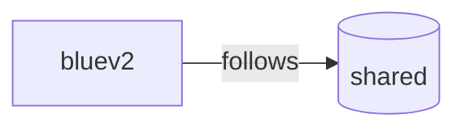

<!-- printerkeep updates the parts between the printerkeep comments. Edit the rest as you like. -->
# Printer configuration

This repository holds the Klipper configuration of several printers, backed up by
[printerkeep](https://github.com/ressu/printerkeep). Each printer has its own branch, named after the printer. This branch,
`shared`, holds the files that the printers share.

## Printers

<!-- printerkeep:begin printers -->
| Printer | Follows from shared |
| --- | --- |
| [bluev2](https://github.com/ressu/klipper-config-backup/tree/bluev2) | `test_speed.cfg`, `stealthburner_leds.cfg`, `mainsail.cfg`, `macros/filament.cfg`, `macros/spoolman.cfg`, `macros/reset.cfg`, `macros/temperature.cfg`, `features/beeper.cfg`, `macros/adaptive_purge.cfg`, `macros/squiggly_purge.cfg` |



Each printer updates its own row when it checks the repository, so the list can be behind for a
while. A printer with printerkeep 1.0 is in the list after you update printerkeep on it.
<!-- printerkeep:end printers -->

## How it works

- **Each printer's branch** holds its config folder, and a README with the steps to restore it. Its
  link is in the list above, or select it in the branch list of the repository.
- **A printer that follows a shared file** gets the changes that are made to it here, and keeps its
  own changes.
- **To change a shared file for all printers**, edit it on one printer. Then copy it to shared from
  that printer.

## On a printer

| To | Run |
| --- | --- |
| See the status of each followed file | `printerkeep status` |
| Follow a shared file | `printerkeep follow "<file>"` |
| Copy a file to shared | `printerkeep copy-to-shared "<file>"` |
| Take one file from another printer | `printerkeep restore "<file>" --printer-name "<printer name>"` |

## Restore a printer

<!-- printerkeep:begin restore -->
Install Klipper, Moonraker, and [printerkeep](https://github.com/ressu/printerkeep#install). Then run this on the printer:

```sh
printerkeep restore --repository https://github.com/ressu/klipper-config-backup --printer-name "<printer name>"
```

`<printer name>` is the name of the printer's branch.
<!-- printerkeep:end restore -->

---

printerkeep updates the parts between the `printerkeep:begin` and `printerkeep:end` comments. You can
edit the rest of this README, and printerkeep keeps your changes.
